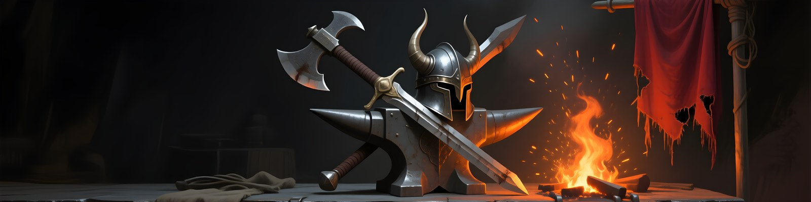
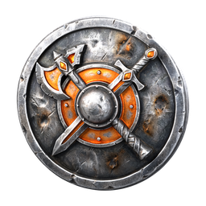

# ForeverWarriorHUD2

A warrior HUD for **World of Warcraft: Forever** (Interface 16001). This is the "2" build: everything in [ForeverWarriorHUD](../../../ForeverWarriorHUD) plus text fonts and formats, player / target / target-of-target frames and minimap options.

 

> **Status: version 2.0.0, not yet verified in the game client.** It passes a mocked-client test
> suite and boots cleanly in a simulated UI, but nobody has confirmed it in the real game. Expect
> rough edges and please report them.

## Install

1. Download this repository (Code -> Download ZIP) or clone it.
2. Put the folder in `World of Warcraft/_forever_/Interface/AddOns/` and make sure it is named exactly `ForeverWarriorHUD2`.
3. Restart the game or `/reload`. Type `/fw2` to open the menu.

Optional companions (the HUD works without them):
- **ForeverArt** - menu artwork: a painted backdrop, a header picture and a class crest.
- **ForeverFonts** - extra typefaces for the Text options.

Do not enable `ForeverWarriorHUD` at the same time: you would get two HUDs.

## How you use it

Open the menu with `/fw2`. **While the menu is open** (and Lock is off), point at any bar or icon:

| Do this | Result |
|---|---|
| Hold **CTRL**, then hold the **left** mouse button | The item sticks to the cursor until you let go |
| Hold **CTRL** and roll the **mouse wheel** | Bigger or smaller |
| Hold **CTRL**, then hold the **right** mouse button and drag | Turns the item; it stays as you leave it |
| **Double-click the right** mouse button | Back to its original orientation |

Icons turn to any angle. Bars and the recent-actions row turn in quarter turns, because the
client cannot draw a status bar at an angle. With the menu closed nothing can be clicked or moved.
Because the mouse does all of this, the menu has no position, scale or orientation controls.
The **Help** tab in the menu explains all of it in game.

## What it shows

- **Rage bar** - rage. Its number has its own on/off switch.
- **Regeneration bar** - what is actually arriving per second.
- **Swing timer** - with its own Show switch, colour, spark, text mode, ticks and ready flash.
- **Combo points** - present but off by default; this class has none.
- **Recent actions** - the last four spells you cast, newest first.
- **Ability icons** - 37 abilities, switched on one by one. On cooldown an icon goes dark and
  grey, a clock sweep runs round it, and the time left counts down to the hundredth of a second in
  its bottom-right corner, drawn above everything else. It also flashes when ready, glows while its
  effect is on you, and dims or turns red when you cannot use it. Every one of these has a switch.
- **Unit frames** - player, target and target-of-target, with cast bar, buffs and debuffs. Opening
  the menu puts all three on screen (switched-off ones dimmed) so each can be moved and sized.
- **Text** - typeface, size, place and number format for each text, beside the thing it labels.
- **Map** - minimap shape, size and clutter.

On by default: Charge, Intercept, Pummel, Overpower, Whirlwind, Bloodrage, Berserker Rage.

## Look

- **40 colour skins**, plus **custom colours**: on the Skins tab click any colour in the strip for a
  colour wheel (with an Opacity slider for the see-through parts), then save your set under a name.
- **Menu artwork** (needs ForeverArt): High resolution, Low resolution or Off, and a choice of header picture.
- **Named profiles**: save, load and delete whole setups. Reset to default keeps them.

## Commands

| Command | What it does |
|---|---|
| `/fw2` | Open or close the menu |
| `/fw2 help` | Open the Help tab |
| `/fw2 abilities`, `skins`, `profiles`, `text`, `frames`, `map` | Open that tab |
| `/fw2 show` / `hide` | Whole HUD on or off |
| `/fw2 energy|regen|swing|combo|trail on|off` | One element on or off ("energy" is the resource bar) |
| `/fw2 cooldown on|off` | Countdown numbers |
| `/fw2 lock` / `unlock`, `sticky`, `grid` | Editing aids |
| `/fw2 skin <name>`, `save <name>`, `load <name>`, `reset` | Skins and profiles |

## Abilities

IDs are rank 1 and only a fallback: at login the addon asks the client for the ID behind each
spellbook name, so an icon follows the rank you actually know.

| Ability | Fallback ID | Default |
|---|---|---|
| Charge | 100 | on |
| Intercept | 20252 | on |
| Pummel | 6552 | on |
| Overpower | 7384 | on |
| Shield Bash | 72 | off |
| Whirlwind | 1680 | on |
| Bloodrage | 2687 | on |
| Berserker Rage | 18499 | on |
| Revenge | 6572 | off |
| Thunder Clap | 6343 | off |
| Taunt | 355 | off |
| Mocking Blow | 694 | off |
| Disarm | 676 | off |
| Intimidating Shout | 5246 | off |
| Shield Block | 2565 | off |
| Recklessness | 1719 | off |
| Retaliation | 20230 | off |
| Shield Wall | 871 | off |
| Mortal Strike | 12294 | off |
| Bloodthirst | 23881 | off |
| Shield Slam | 23922 | off |
| Last Stand | 12975 | off |
| Death Wish | 12328 | off |
| Sweeping Strikes | 12292 | off |
| Piercing Howl | 12323 | off |
| Concussion Blow | 12809 | off |
| Heroic Strike | 78 | off |
| Rend | 772 | off |
| Execute | 5308 | off |
| Hamstring | 1715 | off |
| Sunder Armor | 7386 | off |
| Cleave | 845 | off |
| Slam | 1464 | off |
| Battle Shout | 6673 | off |
| Demoralizing Shout | 1160 | off |
| Victory Rush | 402927 | off |
| Spearing Strike | 1310222 | off |

## How it stays within the client's rules

Public API only. No protected calls, no combat automation, no combat log, nothing written outside
its own SavedVariables. Values the client marks secret are handed to widgets and never compared or
calculated with; a cooldown the addon may not read simply shows no number.

## Known limits

- Not verified in game (see Status).
- Bars turn in quarter turns only; a turned icon's border, sweep and number stay upright. Unit frames move and size but do not turn.
- Glow, dim and red tint depend on what the client will tell an addon; in combat it may withhold
  those answers and the icon then stays plain.
- A few fallback spell IDs are unconfirmed on this client; the name lookup normally corrects them.

## How it is built

This file and the addon are generated: one generator produces all nine class HUDs from a single
reference, so they stay identical in behaviour. A mocked-client suite (722 assertions for this
class), a Lua 5.1 limits check and a simulated UI run are part of every build.
